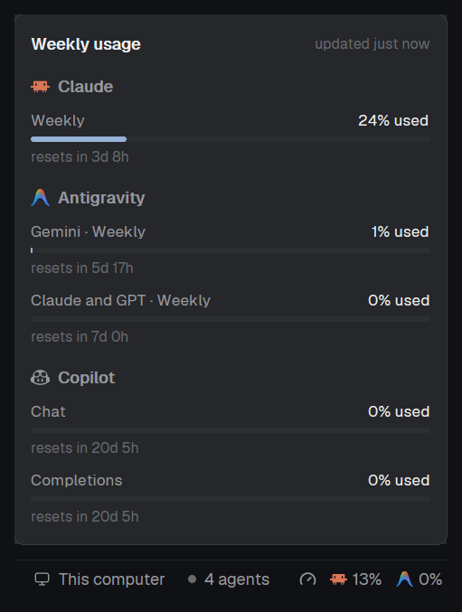

# Quota Gauge for Herdr

Your coding agents' rate limits in Herdr's status bar: each agent's logo and its
5-hour usage after "N agents", and a popup with the weekly limits when clicked.
Claude, Antigravity and Copilot.

The mod is in [`quota-gauge/`](quota-gauge/): see its [`RECIPE.md`](quota-gauge/RECIPE.md).
To add it, ask your agent in Herdr:

> Read ~/.config/herdr-app/AGENTS.md, then add this mod: herdr.dev/mods/amuif/herdr-quota-gauge/quota-gauge

