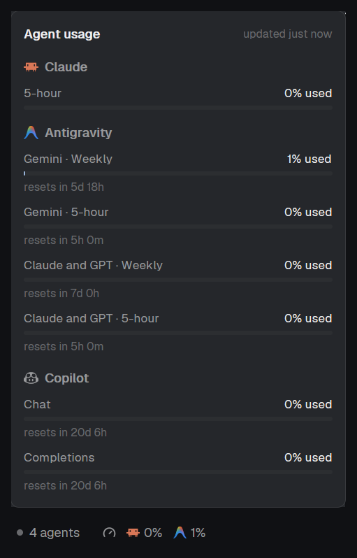

# Agent Usage

Your coding agents' rate limits in Herdr's status bar. After "N agents", each
agent's logo is followed by how much of its tightest limit you've used: Claude
and Antigravity by default. Click it for a popup listing every limit window
(5-hour, weekly, per model group), each with a bar and the time until it resets.

## What you see

- **Status bar** (the shipped `workspace-status` bar, 28px, `chrome`
  background, 11.8px `muted` text): `This computer · <branch> · ● N agents`,
  then the usage item, then the palette hint on the right as before.
- **Usage item:** a 13px gauge icon, then per agent a 13px logo and a
  percentage (`22%`), 10px apart, 4px between logo and number. It's a rounded
  (4px) button with 6px side padding and a `hover` background.
  - Number color: `muted` under 70%, `ansi3` (yellow) from 70%, `blocked`
    (red) from 90%, `dim` when the last refresh failed. `–` when the agent
    has no numbers yet.
  - Before the first answer the item reads `usage…`. While a refresh runs
    the gauge turns `working`.
- **Popup** (`popup`, 320 x 580, `popover` background, 12px padding, 12px
  gaps, scrolls): `Agent usage` (semibold) with `updated just now / 3m ago`
  (10.5px `dim`) on the right. Per agent: a 14px logo and the name
  (semibold, `muted`), then each window: label left (`muted`, 11.5px),
  `N% used` right (`foreground`), a 4px bar (`raised` track, `accent` fill,
  yellow/red past 70/90%), and `resets in 4h 12m` / `resets in 5d 18h`
  (10.5px `dim`). Errors show in `blocked` color under the name.

## How it behaves

- Refreshes every 60 seconds, and when the usage item is clicked (which
  also opens the popup). Esc closes the popup.
- The bar shows each agent's tightest window (the highest `used`). Agents
  marked `bar: false` (Copilot by default) are left out of the bar and
  still listed in the popup.
- A failed refresh (offline, HTTP 429) keeps the agent's last numbers,
  dimmed in the bar, with `Couldn't refresh (HTTP 429), showing last
  numbers` in the popup.
- The last numbers are kept in shared state, so they show at once after a
  restart.
- A Claude window whose reset time has passed counts as 0%.

## Built from

- `mods/workspace-status-usage/`: a `mod.clone` of the shipped
  `workspace-status` (0.1.14) with the usage item added after the agents
  count. Point the layout's status block (id `status`, `"content": { "mod": ... }`,
  28px, at the bottom) at it.
  - `usage.js`: one async function per agent returning
    `{ id, name, icon, tint?, bar?, windows: [{ label, used, resetsAt }], error? }`.
    `used` is 0-100, `resetsAt` ISO or null. `icon` is Herdr's own
    `icons/<agent>.svg`. `tint: true` draws it with `svg()` in `muted`
    (single-color logos), otherwise `image()` keeps its colors.
  - `main.js`: `cx.timer.every(60000)` calls `fetchUsage()` (all agents in
    parallel, each wrapped so one failure doesn't stop the others), merges
    with the previous value (`keepLast`) and stores it with
    `setShared("agent-usage", …)`. On click:
    `openOverlay({ mod: "agent-usage-popup", kind: "popup", width: 320, height: 580 })`.
  - `gauge.svg`: a lucide-style gauge, `currentColor`.
- `mods/agent-usage-popup/`: renders `shared("agent-usage")` only, no
  fetching. Its `mod.json` has
  `"overlay": { "kind": "popup", "width": 320, "height": 580 }`, so
  `mod.open` opens it too.
- Where the numbers come from:
  - **Claude:** `~/.claude/herdr-rate-limits.json`, written by
    `claude/statusline-usage.mjs`. It's a Claude Code status line command:
    it saves the `rate_limits` Claude Code passes to every status line
    (`five_hour` / `seven_day`, `used_percentage` and `resets_at` in Unix
    seconds), only when they change, then runs the status line you had
    before (passed as arguments) with the same input. Set it in
    `~/.claude/settings.json`:
    `"statusLine": { "type": "command", "command": "node ~/.claude/statusline-usage.mjs [previous command]" }`.
    Without that file, the mod falls back to
    `GET https://api.anthropic.com/api/oauth/usage` with the token in
    `~/.claude/.credentials.json` (`Authorization: Bearer`,
    `anthropic-beta: oauth-2025-04-20`).
  - **Antigravity:** `exec("agy", ["-p", "/usage", "--output-format", "json", "--print-timeout", "20s"])`,
    40s timeout. `command.data.groups[].buckets[]` give `window`
    (`5h` / `weekly`), `remaining_fraction` and `reset_time`. Labels are
    `<group> · 5-hour|Weekly`, with " models" dropped from the group name.
  - **Copilot:** `exec("gh", ["auth", "token"])`, then
    `GET https://api.github.com/copilot_internal/user`
    (`Authorization: token …`, `X-GitHub-Api-Version: 2025-04-01`,
    a `User-Agent`). `quota_snapshots.{premium_interactions, chat, completions}`,
    shown only when not `unlimited` and `entitlement > 0`;
    `used = 100 - percent_remaining`; resets at `quota_reset_date`.
- Uses: `exec`, `fetch`, `readTextFile`, `home`, `shared` / `setShared`,
  `openOverlay`, `theme`, plus everything the shipped `workspace-status` uses.

## Watch out

- **This mod reaches the network, runs programs and reads files outside
  its folder:** it reads `~/.claude/herdr-rate-limits.json` and (fallback)
  `~/.claude/.credentials.json`, runs `agy` and `gh auth token`, and calls
  `api.anthropic.com` (fallback only) and `api.github.com`. Tokens are only
  sent to the service they belong to.
- **Don't poll Claude's usage endpoint.** It's rate limited per account
  (HTTP 429 with `Retry-After: 180`), shared with anything else that polls
  it, and Herdr's `fetch` doesn't expose response headers. The status line
  file avoids it entirely. Its numbers update only while a Claude Code
  session is running, which is when they change.
- **`agy -p /usage` must reach agy as the literal `/usage`.** Git Bash
  (MSYS) rewrites a leading `/` into a Windows path, and agy then runs it
  as a prompt: a real agent turn that spends quota. `exec` passes it
  through unchanged. Don't wrap it in `cmd /c "..."` either: in Herdr that
  hung until the timeout. Needs agy 1.1.11 or newer.
- A `mod.clone`d bar doesn't follow later changes to the shipped
  `workspace-status`.
- Herdr's shipped layouts are read-only: clone the layout
  (`layout.clone`) and point the clone's status block at
  `workspace-status-usage`.
- Copilot's `copilot_internal` endpoint is undocumented. On the free plan
  premium requests have `entitlement: 0` and are hidden.
- To show an agent in the bar or hide it, set or remove `bar: false` on
  its `base` in `usage.js`. To add an agent, add a function to
  `PROVIDERS`.

## Done when

- `herdr-app check` passes for both mod folders.
- The status bar shows the gauge, then a logo and percentage for Claude
  and Antigravity, right after `N agents`.
- Clicking the usage item opens the popup listing Claude (5-hour, Weekly),
  Antigravity (four windows) and Copilot, with bars and reset times, and
  `updated just now`.
- After a Claude Code reply, `~/.claude/herdr-rate-limits.json` exists and
  the Claude numbers in the popup match Claude Code's `/usage`.
- Two refreshes, read from `shared.json`'s `agent-usage.updatedAt`, are
  about 60 seconds apart.
- With the network off, the bar keeps the last numbers dimmed and the
  popup says `Couldn't refresh (…), showing last numbers`.
